# 🎮 Mortal Store

Mortal Store es un proyecto desarrollado **progresivamente durante el bimestre**. Esta versión consolida los aprendizajes de HTML5, CSS3, Bootstrap 5, JavaScript y React en una tienda de videojuegos con catálogo dinámico, filtros, carrito y formulario de contacto.

Este documento **conserva la explicación técnica y las evidencias generadas en Semana 8**, e incorpora la información necesaria para instalar, utilizar y evaluar la versión final de Semana 9. El catálogo se mantiene en un archivo JSON; las acciones de agregar, modificar cantidades y eliminar productos corresponden al **carrito de compras**, no a un panel de administración del catálogo.

---

## 🎯 Objetivo del proyecto

El objetivo de la evaluación final es presentar una aplicación eCommerce funcional, modular y responsiva, integrando los contenidos desarrollados durante el bimestre.

A lo largo de las distintas semanas se trabajó en la estructura HTML, la presentación mediante CSS, la incorporación de Bootstrap, la interactividad con JavaScript y la organización de la aplicación mediante componentes React.

En Semana 8 se profundizó especialmente en el uso de Hooks de React para administrar estados y efectos secundarios.

La aplicación permite cargar dinámicamente un catálogo de videojuegos, buscar y filtrar productos, agregarlos al carrito, modificar sus cantidades, eliminarlos y calcular automáticamente el total de la compra.

Además, se implementa renderizado condicional para modificar la interfaz según el estado de la aplicación, persistencia del carrito mediante Local Storage y estados de carga y error durante la obtención del catálogo.

---

## 🛠️ Tecnologías utilizadas

### HTML5 — Estructura de la aplicación

Se utiliza HTML5 para organizar el contenido de Mortal Store y establecer una estructura clara para las diferentes secciones de la tienda.

La aplicación incorpora elementos semánticos que permiten identificar las áreas principales de la interfaz, como el encabezado, la navegación, el contenido principal y el pie de página.

También se utilizan encabezados, párrafos, imágenes, enlaces, botones y elementos de formulario para presentar la información de los videojuegos y permitir la interacción del usuario.

En React, esta estructura se representa mediante JSX, lo que permite combinar la organización del contenido con los componentes funcionales de la aplicación.

El uso de HTML semántico contribuye a mejorar la comprensión del documento, su mantenimiento y la accesibilidad de la interfaz.

### CSS3 — Estilos y presentación visual

Se utiliza CSS3 para personalizar la apariencia de Mortal Store y mantener una identidad visual coherente en todas sus secciones.

Las hojas de estilo permiten configurar propiedades como:

- Colores de fondo y de texto.
- Tipografías y tamaños de fuente.
- Márgenes y espaciados.
- Bordes y elementos decorativos.
- Dimensiones de imágenes.
- Presentación de tarjetas de productos.
- Distribución y alineación de elementos.
- Comportamiento visual en diferentes resoluciones.

Los estilos personalizados se encuentran principalmente en:

```text
src/App.css
src/index.css
```

Estos archivos complementan los estilos proporcionados por Bootstrap 5.

Además, se utilizan técnicas de diseño responsivo para adaptar la presentación de los componentes al tamaño de la pantalla.

De esta manera, la aplicación mantiene una distribución adecuada tanto en equipos de escritorio como en tabletas y teléfonos móviles.

### Bootstrap 5 — Componentes y diseño responsivo

Se utiliza Bootstrap 5 para facilitar la construcción de una interfaz organizada, consistente y adaptable a diferentes dispositivos.

La aplicación incorpora componentes y clases de Bootstrap en distintas secciones, entre ellas:

- Barra de navegación.
- Carrusel de videojuegos destacados.
- Tarjetas del catálogo.
- Botones de interacción.
- Formulario de contacto.
- Distribución de contenidos.
- Alineación y espaciado de elementos.

El sistema de distribución de Bootstrap permite organizar los productos de acuerdo con el espacio disponible.

En pantallas amplias, los videojuegos se presentan mediante una distribución de varias columnas, mientras que en dispositivos móviles las tarjetas se reorganizan para facilitar su visualización.

La combinación de Bootstrap 5 y CSS personalizado permite mantener la identidad visual de Mortal Store sin perder las ventajas de una interfaz responsiva.

### JavaScript — Interactividad y contenido dinámico

Se utiliza JavaScript para implementar las funcionalidades interactivas de Mortal Store y responder a las acciones realizadas por el usuario.

Entre las operaciones desarrolladas se encuentran:

- Búsqueda de videojuegos por nombre.
- Filtrado de productos por categoría.
- Incorporación de videojuegos al carrito.
- Incremento y disminución de cantidades.
- Eliminación de productos del carrito.
- Cálculo de subtotales y totales.
- Actualización de la información presentada.
- Validación del formulario de contacto.
- Almacenamiento de información en Local Storage.

También se utiliza JavaScript para obtener los datos del catálogo desde un archivo JSON mediante `fetch`.

Estas funcionalidades permiten que la información mostrada en la tienda cambie dinámicamente, sin necesidad de modificar manualmente el contenido HTML cada vez que el usuario realiza una acción.

### React — Componentes y gestión de estados

Se utiliza React para desarrollar Mortal Store mediante componentes funcionales reutilizables.

Esta organización permite dividir la interfaz en diferentes partes, asignando responsabilidades específicas a cada componente.

Por ejemplo, el catálogo, los filtros, el carrito y el formulario de contacto se implementan mediante componentes independientes que trabajan de manera coordinada.

La aplicación utiliza los siguientes conceptos de React:

**Componentes funcionales**

Permiten organizar y reutilizar elementos de la interfaz.

**Props**

Permiten compartir información y funciones entre componentes, facilitando la comunicación entre las diferentes partes de la aplicación.

**useState**

Permite administrar información que cambia durante la interacción del usuario, como el catálogo, los filtros, las cantidades del carrito y los datos del formulario.

**useEffect**

Permite ejecutar efectos secundarios relacionados con la carga del catálogo y la persistencia de la información del carrito.

**Renderizado condicional**

Permite mostrar mensajes, indicadores y controles diferentes según el estado de la aplicación.

**Manejo de eventos**

Permite responder a las acciones del usuario mediante eventos como `onClick`, `onChange` y `onSubmit`.

El uso de estos recursos permite mantener una aplicación modular, interactiva y organizada.

### Vite — Entorno de desarrollo

Se utiliza Vite como herramienta de desarrollo y compilación de Mortal Store.

Vite permite iniciar un servidor local para trabajar con la aplicación, visualizar los cambios durante el desarrollo y generar una versión optimizada para producción.

Los principales comandos utilizados son:

```bash
npm run dev
npm run build
npm run preview
```

La compilación de producción genera los archivos necesarios para publicar la aplicación.

### JSON y Fetch API — Gestión del catálogo

La información de los videojuegos se encuentra almacenada en un archivo JSON:

```text
public/data/productos.json
```

Este archivo contiene los datos utilizados para construir dinámicamente las tarjetas del catálogo.

La aplicación utiliza `fetch` para solicitar el archivo JSON y posteriormente almacena la información recibida en el estado de React.

Esta implementación permite mantener separados los datos del catálogo y los componentes encargados de presentarlos.

### Local Storage — Persistencia de información

Se utiliza Local Storage para conservar la información del carrito de compras en el navegador.

Cuando el usuario agrega productos o modifica sus cantidades, el contenido del carrito se actualiza y se guarda localmente.

De esta manera, los productos seleccionados permanecen disponibles después de recargar la página.

La persistencia se administra mediante React y los mecanismos de almacenamiento proporcionados por JavaScript.

### Git y GitHub — Control de versiones

Se utiliza Git para registrar los cambios realizados durante el desarrollo de Mortal Store.

GitHub permite almacenar el código fuente en un repositorio remoto y mantener disponible la documentación del proyecto.

Para la Evaluación Final Transversal se utiliza un repositorio que contiene los archivos de la aplicación, las imágenes, las capturas y el README.

### GitHub Pages — Publicación de la aplicación

Se utiliza GitHub Pages para publicar Mortal Store y permitir su visualización desde un navegador mediante una dirección pública.

La versión de producción se genera con Vite y se publica utilizando la herramienta `gh-pages`.

La publicación de Semana 9 fue realizada correctamente y se comprobó que la aplicación carga su página principal, el catálogo y las imágenes de los videojuegos.

### Visual Studio Code — Entorno de trabajo

Se utiliza Visual Studio Code como editor para desarrollar y organizar los archivos del proyecto.

Desde este entorno se trabaja con los componentes React, las hojas de estilo, el archivo JSON y la configuración de Vite.

También se utiliza su terminal integrada para ejecutar comandos de npm y Git.

### ESLint — Revisión del código

El proyecto incorpora ESLint como herramienta de análisis estático del código JavaScript y React.

Su configuración se encuentra en:

```text
eslint.config.js
```

La herramienta permite identificar posibles problemas de programación y mantener criterios de calidad en el código.

El proyecto dispone del comando:

```bash
npm run lint
```

La ejecución final de esta verificación queda pendiente de confirmar.

---

## ⚙️ Funcionalidades implementadas

### 📦 Carga dinámica del catálogo

Los productos utilizados por la aplicación se encuentran almacenados en:

```text
public/data/productos.json
```

El catálogo se carga dinámicamente mediante `fetch` dentro de un `useEffect`.

Al recibir correctamente la información, los datos son utilizados para actualizar el estado del catálogo mediante `setProductos`.

Cada producto contiene información como:

- Nombre.
- Categoría.
- Precio normal.
- Precio de oferta.
- Descripción.
- Imagen.

De esta manera, los productos no se importan directamente desde JavaScript, sino que son obtenidos dinámicamente desde el archivo JSON.

La información recibida se utiliza para generar las tarjetas de los videojuegos mediante componentes React.

Esta implementación permite mantener una separación entre los datos del catálogo y la presentación visual de los productos.

### 🧩 Componentes funcionales

La aplicación está organizada mediante componentes funcionales reutilizables.

Entre los principales componentes se encuentran:

- `Header`
- `Navbar`
- `HeroCarousel`
- `ProductFilter`
- `ProductList`
- `ProductCard`
- `Cart`
- `InfoSection`
- `ContactForm`
- `Footer`

Esta organización permite separar las responsabilidades de la interfaz y mantener una estructura modular.

Por ejemplo, `ProductList` organiza la presentación del catálogo, mientras que `ProductCard` representa individualmente cada videojuego.

De manera similar, `Cart` administra la presentación del carrito y `ContactForm` contiene los elementos correspondientes al formulario de contacto.

### 🔄 Props y estados

La aplicación utiliza propiedades (`props`) para compartir información y funciones entre componentes.

El Hook `useState` administra diferentes estados de la aplicación, entre ellos:

- Catálogo de productos.
- Productos seleccionados en el carrito.
- Cantidades de productos.
- Texto ingresado en el buscador.
- Categoría seleccionada.
- Estado de carga del catálogo.
- Estado de error durante la carga.
- Datos ingresados en el formulario.
- Estado del envío del formulario.

Cuando alguno de estos estados cambia, React actualiza los elementos de la interfaz que dependen de esa información.

Por ejemplo, al agregar un videojuego al carrito, se actualiza la cantidad seleccionada y la información presentada tanto en el catálogo como en el carrito de compras.

### ⚡ useEffect y carga de productos

Al iniciar la aplicación, `useEffect` ejecuta una función asíncrona encargada de solicitar el archivo JSON mediante `fetch`.

El flujo utilizado es:

```text
productos.json
      ↓
    fetch()
      ↓
  useEffect()
      ↓
 setProductos()
      ↓
actualización del catálogo
```

Durante este proceso se administran estados de carga y error para informar adecuadamente al usuario.

Si la información se obtiene correctamente, los productos se muestran en el catálogo.

En caso de producirse un problema durante la carga, la aplicación presenta un mensaje de error.

### 💾 useEffect y persistencia del carrito

La aplicación utiliza además otro `useEffect` para guardar automáticamente el contenido del carrito en Local Storage cuando se producen cambios.

Gracias a esta funcionalidad, los productos y cantidades agregados permanecen disponibles después de actualizar o recargar la página.

La persistencia permite conservar la selección del usuario durante su navegación en el mismo navegador.

### 🔎 Búsqueda de productos

La aplicación incorpora un campo de búsqueda que permite localizar videojuegos por su nombre.

El contenido mostrado se actualiza dinámicamente mediante `onChange` y el estado administrado por React.

Cuando el usuario escribe en el buscador, se actualiza la información utilizada para filtrar los productos.

Si ningún videojuego coincide con el texto ingresado, se muestra un mensaje informativo mediante renderizado condicional.

### 🎮 Filtros por categoría

Los productos pueden filtrarse según su categoría.

Las categorías disponibles son:

- Todas.
- Deportes.
- Aventura.
- Lucha.

Los filtros pueden combinarse con la búsqueda por nombre.

La selección de una categoría actualiza el catálogo mostrado sin necesidad de recargar la página.

### 🛒 Carrito de compras

El carrito permite:

- Agregar productos.
- Incrementar cantidades mediante el botón `+`.
- Disminuir cantidades mediante el botón `−`.
- Eliminar automáticamente un producto cuando su cantidad llega a cero.
- Eliminar completamente un producto mediante el botón `Eliminar`.
- Solicitar confirmación antes de eliminar completamente un producto.
- Visualizar la cantidad de cada producto.
- Calcular el subtotal correspondiente.
- Calcular la cantidad total de productos.
- Calcular automáticamente el precio total de la compra.
- Mantener el carrito después de recargar la página.

El carrito utiliza los estados de React para actualizar las cantidades y los cálculos correspondientes.

Los cambios realizados se reflejan automáticamente en la interfaz.

### 🔀 Renderizado condicional

La interfaz modifica los elementos mostrados según el estado de la aplicación.

Entre los casos implementados se encuentran:

- Mensaje mientras se cargan los productos.
- Mensaje cuando ocurre un error durante la carga.
- Mensaje cuando el carrito está vacío.
- Mensaje cuando una búsqueda o filtro no encuentra productos.
- Indicador `En el carrito` cuando un producto ya fue agregado.
- Visualización de la cantidad de unidades agregadas.
- Cambio del botón `Agregar al carrito` por `Agregar otra unidad`.
- Cambio del estilo del botón según el estado del producto.
- Mensaje de confirmación después de enviar el formulario de contacto.

El renderizado condicional permite que la aplicación entregue información visual relacionada con las acciones del usuario.

### 🧮 Reutilización de lógica y componentes

La aplicación organiza las funcionalidades de catálogo, filtrado, carrito y presentación en componentes React.

Las funciones reutilizables de cálculo del carrito y formato de precios se encuentran en:

```text
src/utils/cartUtils.js
src/utils/formatters.js
```

Esta organización permite reutilizar operaciones sin repetir innecesariamente la misma lógica en diferentes componentes.

### ⚡ Manejo de eventos

La aplicación utiliza diferentes eventos de React, entre ellos:

- `onClick`
- `onChange`
- `onSubmit`

Estos eventos permiten controlar el carrito, filtros, búsqueda y formulario de contacto.

`onClick` se utiliza para responder a acciones realizadas mediante botones.

`onChange` permite actualizar la información ingresada o seleccionada por el usuario.

`onSubmit` permite controlar el procesamiento del formulario de contacto.

### ✉️ Formulario de contacto

La aplicación mantiene un formulario controlado mediante React.

El formulario permite ingresar:

- Nombre.
- Correo electrónico.
- Mensaje.

Se realizan validaciones para comprobar que los campos requeridos estén completos y que el correo electrónico tenga un formato válido.

Después de realizar el envío se muestra un mensaje de confirmación mediante renderizado condicional y los campos son limpiados automáticamente.

El formulario demuestra el manejo de eventos, estados y validaciones mediante React.

No se realiza el envío de un correo electrónico real.

### 🎠 Carrusel de productos

La página incorpora un carrusel desarrollado con Bootstrap para mostrar videojuegos destacados.

El carrusel permite:

- Cambio automático de imágenes.
- Navegación mediante controles anterior y siguiente.
- Navegación mediante indicadores.

Este componente permite destacar visualmente los videojuegos y complementar la presentación del catálogo.

### 📱 Diseño responsive

La interfaz utiliza Bootstrap 5 y estilos CSS personalizados para adaptarse a diferentes tamaños de pantalla.

Se realizaron pruebas tanto en resolución de escritorio como en dispositivos móviles.

En resolución móvil, el catálogo reorganiza las tarjetas en una sola columna y adapta sus elementos al ancho disponible.

El diseño responsivo fue comprobado mediante las herramientas de desarrollo del navegador, utilizando diferentes dimensiones de pantalla.

### ♿ Accesibilidad

Se incorporaron diferentes elementos orientados a mejorar la accesibilidad de la aplicación, entre ellos:

- Textos alternativos en imágenes.
- Etiquetas asociadas a campos de formulario.
- Atributos `aria-label`.
- Atributos `aria-labelledby`.
- Mensajes con `role="alert"`.
- Botones identificados según su función.

Estos recursos permiten entregar información adicional sobre los elementos de la interfaz y facilitan su identificación.

---

## 🆕 Mejoras implementadas en Semana 8 (registro histórico)

A partir del proyecto desarrollado durante la Semana 7, esta versión incorpora:

- Gestión del catálogo mediante `useState`.
- Carga dinámica del catálogo mediante `useEffect`.
- Obtención de productos con `fetch`.
- Archivo JSON local como fuente dinámica de datos.
- Estados de carga y error.
- Renderizado condicional según el estado de los productos.
- Cambio de texto y estilo de botones según el carrito.
- Eliminación completa de productos.
- Confirmación antes de eliminar un producto.
- Centralización del formato de precios.
- Separación de cálculos del carrito en funciones reutilizables.
- Mantención de la persistencia mediante Local Storage.

Estas mejoras forman parte de la evolución de Mortal Store durante el bimestre y se mantienen en la versión consolidada de la Evaluación Final Transversal.

---

## 📁 Estructura actual del proyecto — Semana 9

La siguiente estructura corresponde a los archivos comprobados en la versión final. Se conservan también los recursos y las capturas de etapas anteriores.

```text
Mortal_Store_EFT_Semana9_Etapa1/
├── .gitignore
├── README.md
├── eslint.config.js
├── index.html
├── package.json
├── package-lock.json
├── public/
│   ├── capturas/
│   │   ├── 01-carga-dinamica.png
│   │   ├── 02-carrito.png
│   │   ├── 03-renderizado-condicional.png
│   │   ├── 04-carrito-vacio.png
│   │   ├── 05-sin-resultados.png
│   │   ├── 06-responsive.png
│   │   ├── 07-pagina-principal.png
│   │   ├── 08-catalogo-productos.png
│   │   ├── 09-busqueda-filtros.png
│   │   ├── 10-carrito-compras.png
│   │   ├── 11-formulario-contacto.png
│   │   └── 12-diseno-responsive.png
│   ├── data/
│   │   └── productos.json
│   ├── img/
│   │   ├── fc26.jpg
│   │   ├── minecraft.jpg
│   │   └── mortal-kombat.jpg
│   ├── favicon.svg
│   └── icons.svg
├── src/
│   ├── App.css
│   ├── App.jsx
│   ├── index.css
│   ├── main.jsx
│   ├── assets/
│   │   ├── hero.png
│   │   ├── react.svg
│   │   └── vite.svg
│   ├── components/
│   │   ├── Cart.jsx
│   │   ├── ContactForm.jsx
│   │   ├── Footer.jsx
│   │   ├── Header.jsx
│   │   ├── HeroCarousel.jsx
│   │   ├── InfoSection.jsx
│   │   ├── Navbar.jsx
│   │   ├── ProductCard.jsx
│   │   ├── ProductFilter.jsx
│   │   └── ProductList.jsx
│   └── utils/
│       ├── cartUtils.js
│       └── formatters.js
└── vite.config.js
```

**Nota:** `node_modules/` contiene dependencias instaladas y `dist/` es el resultado de compilar para producción; no forman parte de la estructura fuente mostrada.

---

## 🚀 Instalación y ejecución — Semana 9

### Requisitos previos

- Node.js y npm instalados.
- Git para clonar el repositorio (o descargar el código fuente desde GitHub).
- Un navegador moderno, como Chrome, Edge o Firefox.

### 1. Clonar el repositorio de la EFT

```bash
git clone https://github.com/FranciscoHenriquezAlvarez/Bimestre_08_DFI_EFT_S9_FranciscoHenriquez.git
cd Bimestre_08_DFI_EFT_S9_FranciscoHenriquez
```

### 2. Instalar dependencias

```bash
npm install
```

### 3. Iniciar el servidor de desarrollo

```bash
npm run dev
```

Abrir en el navegador la dirección local indicada por Vite (habitualmente `http://localhost:5173/`).

Para detener el servidor, presionar `Ctrl + C` en su terminal.

### 4. Generar la versión de producción

```bash
npm run build
```

La compilación genera la carpeta `dist/`.

### 5. Probar la versión de producción

```bash
npm run preview
```

Abrir la dirección indicada por Vite (habitualmente `http://localhost:4173/`).

### 6. Verificar el código con ESLint

El proyecto dispone del script `lint` en `package.json`.

```bash
npm run lint
```

### 7. Publicar en GitHub Pages

El proyecto dispone de los scripts `predeploy` y `deploy`, junto con la dependencia `gh-pages`.

```bash
npm run deploy
```

Este comando ejecuta la compilación de producción y publica el contenido de `dist/` en la rama `gh-pages`.

**Comprobaciones efectuadas para la EFT:**

- `npm run build` finalizó sin errores.
- `npm run preview` permitió verificar el funcionamiento de la aplicación.
- `npm run deploy` publicó correctamente la versión de producción.
- La ejecución final de ESLint queda pendiente de confirmar.

---

## 🧭 Cómo utilizar Mortal Store

1. Abrir la aplicación y explorar los tres videojuegos disponibles: **EA SPORTS FC 26**, **Minecraft** y **Mortal Kombat**.

2. Utilizar el buscador por nombre y el selector de categoría (Todas, Deportes, Aventura o Lucha). Ambos filtros pueden combinarse.

3. Presionar **Agregar al carrito** en un videojuego. Si ya está agregado, utilizar **Agregar otra unidad**.

4. En **Carrito de compras**, utilizar `+` y `−` para ajustar cantidades, o **Eliminar** para retirar un producto. El subtotal y el total se actualizan automáticamente.

5. Recargar la página si se desea comprobar que el carrito se conserva mediante `localStorage` en el mismo navegador.

6. Utilizar el formulario **Contacto** para ingresar nombre, correo y mensaje. El formulario valida los datos y muestra una confirmación visual; **no realiza el envío de un correo electrónico real**.

El catálogo se obtiene desde `public/data/productos.json` mediante `fetch`, `useEffect` y `useState`.

El archivo JSON es la fuente de datos del catálogo; **la tienda no incluye una interfaz pública de administración para agregar o eliminar videojuegos del catálogo**.

---

## 🌐 Repositorios y publicación

### Evaluación Final Transversal — Semana 9

**Repositorio de GitHub:**

https://github.com/FranciscoHenriquezAlvarez/Bimestre_08_DFI_EFT_S9_FranciscoHenriquez

**Aplicación publicada en GitHub Pages:**

https://franciscohenriquezalvarez.github.io/Bimestre_08_DFI_EFT_S9_FranciscoHenriquez/

### Registro histórico — Semana 8

**Repositorio de GitHub:**

https://github.com/FranciscoHenriquezAlvarez/Bimestre_08_DFI_Exp3_S8_FranciscoHenriquez

**Publicación de GitHub Pages:**

https://franciscohenriquezalvarez.github.io/Bimestre_08_DFI_Exp3_S8_FranciscoHenriquez/

La publicación de Semana 8 se conserva como evidencia de la evolución del proyecto.

La versión de Semana 9 se desplegó mediante `npm run deploy` en la rama `gh-pages`.

Se comprobó que la aplicación publicada carga correctamente la página principal, los tres videojuegos y sus imágenes.

---

## 🖼️ Evidencias de funcionamiento conservadas de Semana 8

### Carga dinámica del catálogo

Los productos son obtenidos dinámicamente desde el archivo JSON mediante `fetch` y posteriormente se muestran en el catálogo.

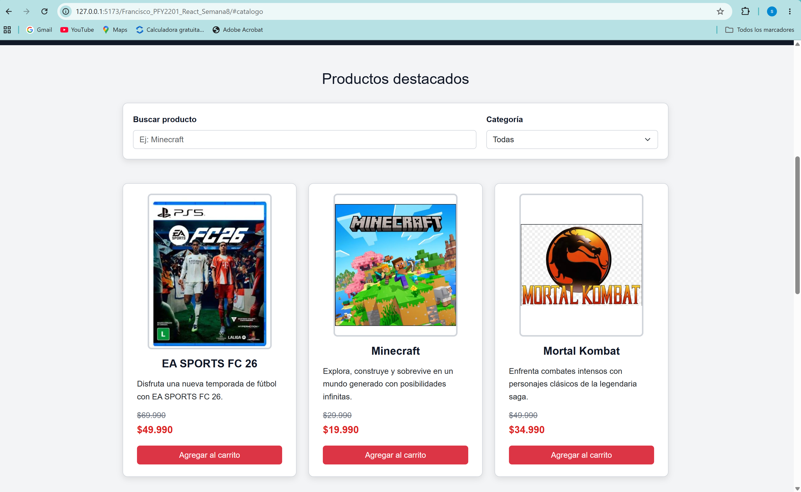

### Carrito de compras

El carrito permite agregar productos, modificar cantidades, eliminar productos y calcular automáticamente subtotales y totales.

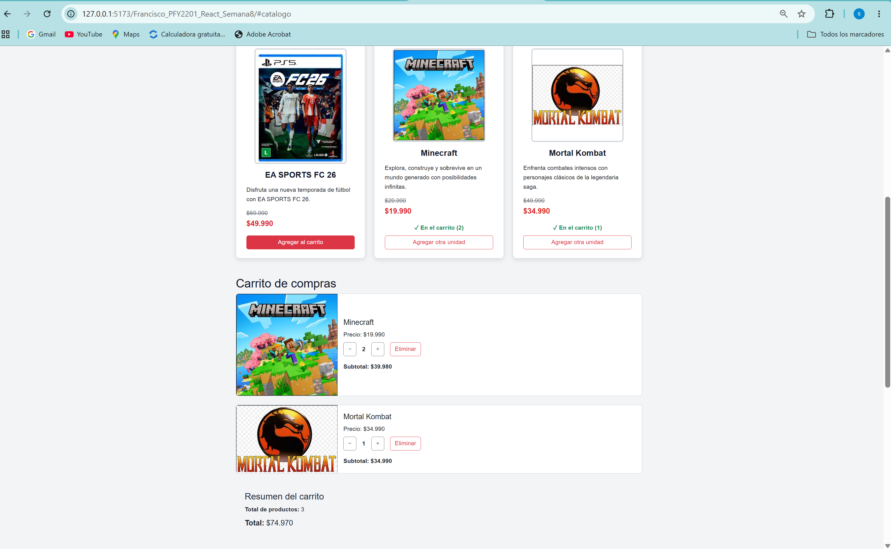

### Renderizado condicional

Cuando un producto ya se encuentra agregado al carrito, la interfaz muestra su estado y cantidad y modifica el texto y estilo del botón.

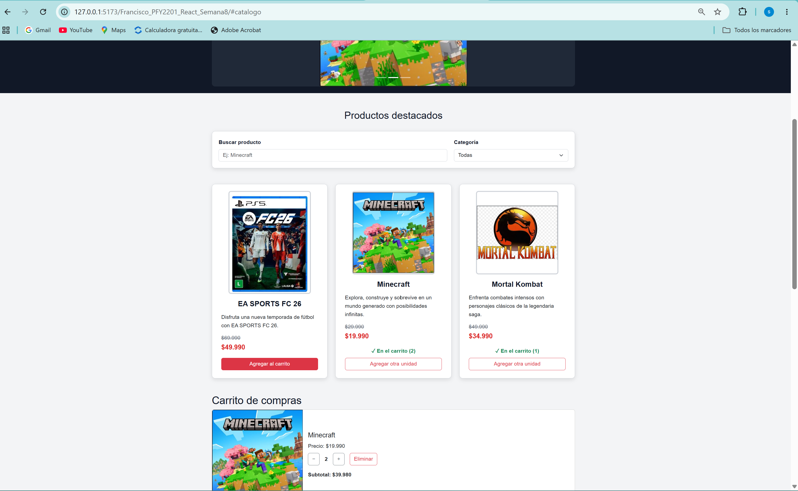

### Carrito vacío

Cuando no existen productos agregados se muestra un mensaje informativo mediante renderizado condicional.

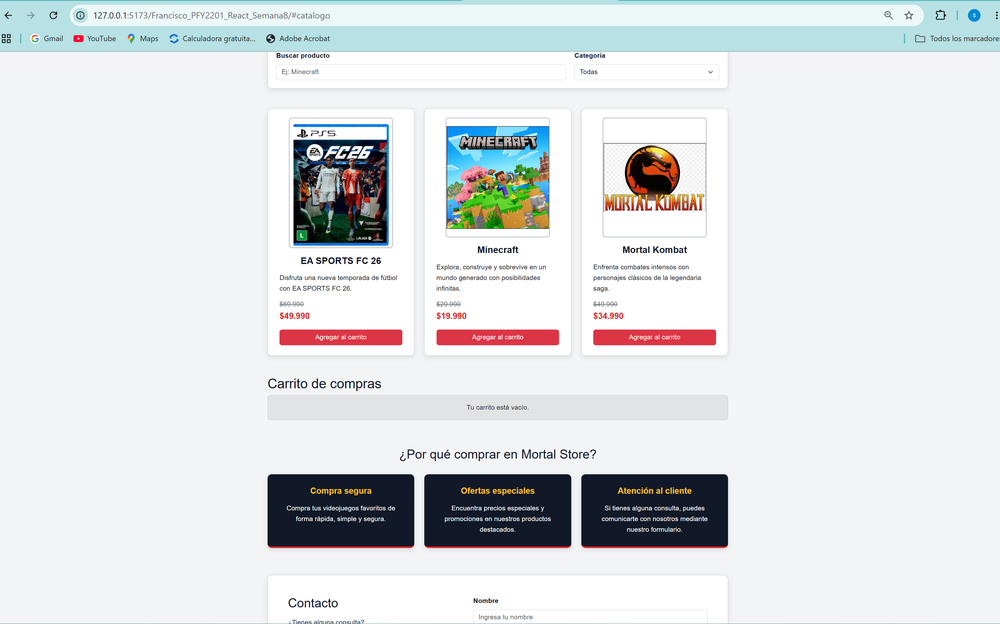

### Búsqueda sin resultados

Cuando ningún producto coincide con los criterios de búsqueda se muestra un mensaje de advertencia.

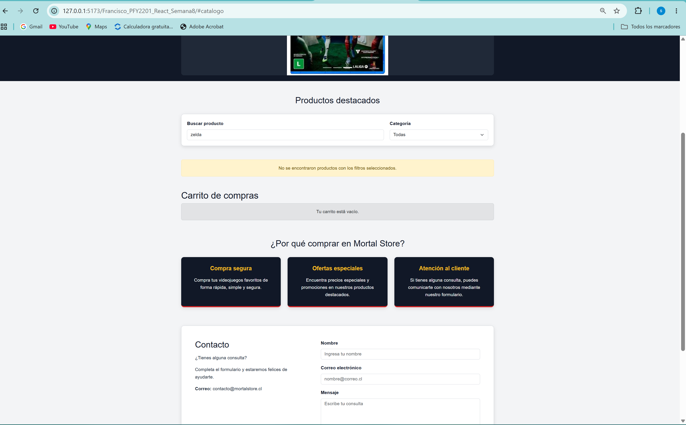

### Diseño responsive

La aplicación fue probada en un viewport móvil de 375 × 667 píxeles para comprobar la adaptación de la interfaz.

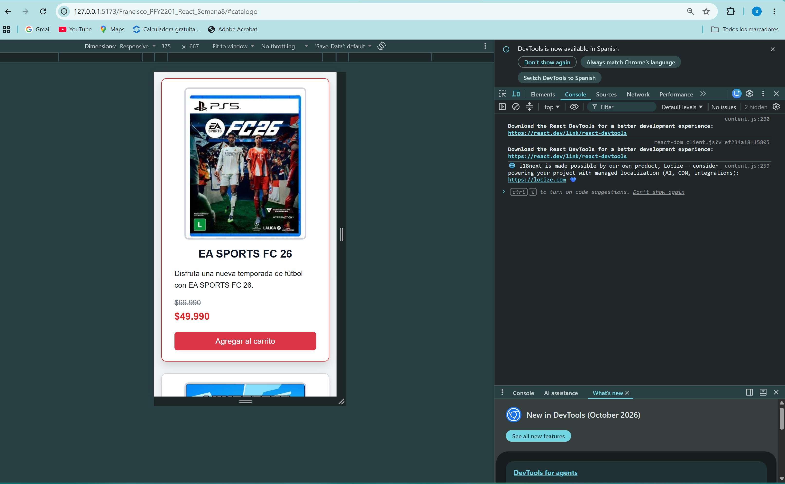

---

## 📸 Evidencias de la Evaluación Final Transversal — Semana 9

Estas seis capturas complementan las evidencias de Semana 8 y muestran la versión consolidada de Mortal Store.

Se mantienen los nombres correlativos de la carpeta `public/capturas/`.

### 07. Página principal

Vista general de la tienda, su encabezado, navegación y carrusel de productos destacados.

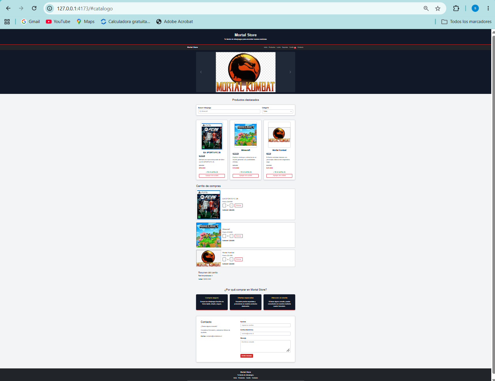

### 08. Catálogo de productos

Visualización de las tarjetas de EA SPORTS FC 26, Minecraft y Mortal Kombat, con imágenes, categorías, descripciones, precios y botones para agregar al carrito.

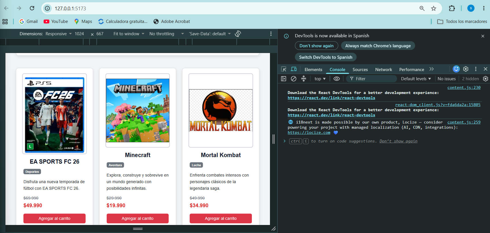

### 09. Búsqueda y filtros

Evidencia del uso de la búsqueda por nombre y los filtros de categoría para seleccionar los productos mostrados.


### 10. Carrito de compras

Evidencia de los productos seleccionados, el control de cantidades y los cálculos de subtotales y total.

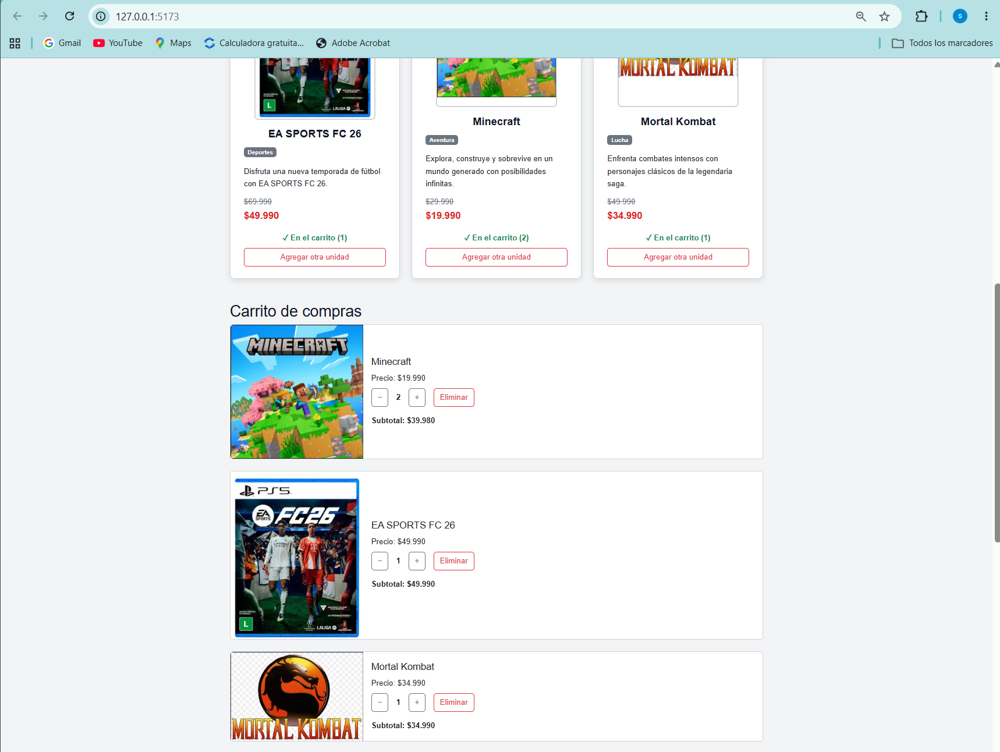

### 11. Formulario de contacto

Vista del formulario de contacto y de su funcionamiento en la interfaz.

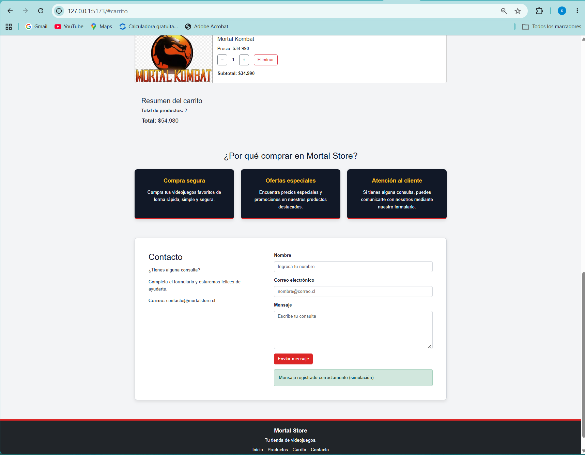

### 12. Diseño responsivo

Vista de la aplicación en un ancho móvil de 320 píxeles, con el catálogo adaptado a una columna.

Se muestran las herramientas de desarrollo utilizadas para comprobar las dimensiones de la pantalla.

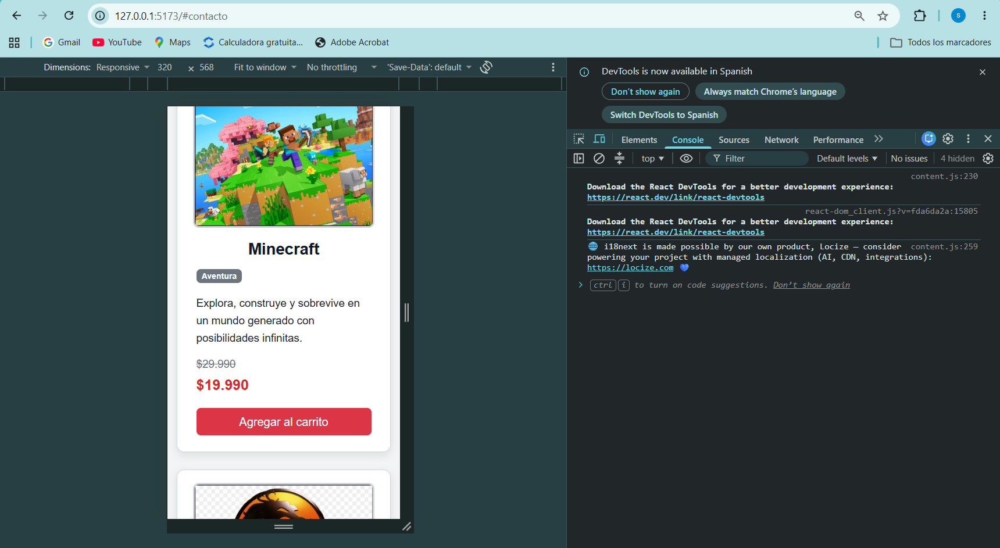

---

## ✅ Pruebas realizadas

Antes de finalizar la entrega se verificó:

- Carga dinámica del catálogo.
- Actualización del estado después de obtener los datos.
- Manejo de errores durante una carga fallida.
- Búsqueda de productos.
- Filtro por categoría.
- Agregar productos al carrito.
- Aumentar y disminuir cantidades.
- Eliminación automática al llegar a cero unidades.
- Eliminación completa mediante el botón `Eliminar`.
- Confirmación antes de eliminar.
- Cálculo de subtotales.
- Cálculo del total de productos.
- Cálculo del valor total del carrito.
- Actualización del contador del carrito.
- Renderizado condicional de productos agregados.
- Mensaje de carrito vacío.
- Mensaje de búsqueda sin resultados.
- Persistencia mediante Local Storage.
- Formulario de contacto.
- Diseño responsive.
- Revisión de la consola del navegador.
- Disponibilidad del script de verificación mediante ESLint.
- Compilación de producción mediante Vite.
- Publicación mediante GitHub Pages.

**Nota:** la ejecución final de ESLint todavía debe confirmarse.

---

## 🧪 Verificaciones de la Evaluación Final Transversal — Semana 9

Durante la revisión final se realizaron **15 pruebas funcionales y de compatibilidad**, todas con resultado satisfactorio:

| Prueba | Resultado |
|---|---|
| Carga del catálogo e imágenes | Aprobada |
| Búsqueda de videojuegos | Aprobada |
| Filtro por categoría | Aprobada |
| Búsqueda y categoría combinadas | Aprobada |
| Incorporación de productos al carrito | Aprobada |
| Incremento y disminución de cantidades | Aprobada |
| Eliminación de productos del carrito | Aprobada |
| Persistencia del carrito tras recargar y reabrir la pestaña | Aprobada |
| Validaciones del formulario de contacto | Aprobada |
| Navegación y controles del carrusel | Aprobada |
| Diseño de escritorio (1920 × 1080) | Aprobada |
| Diseño de tablet (768 × 1024) | Aprobada |
| Diseño móvil (375 × 812) | Aprobada |
| Diseño móvil estrecho (320 × 568) | Aprobada |
| Funcionamiento en un segundo navegador | Aprobada |

Además, se comprobó que:

- `npm run build` genera correctamente la versión de producción.
- `npm run preview` ejecuta la versión compilada sin problemas observados.
- `npm run deploy` publica correctamente la aplicación en GitHub Pages.
- La aplicación pública muestra correctamente la página principal, los tres videojuegos y sus imágenes.

Estas verificaciones se realizaron durante la preparación de la entrega final.

---

## 📌 Estado de la entrega final

Mortal Store presenta un catálogo dinámico, componentes React reutilizables, comunicación mediante `props`, gestión de estado con `useState`, efectos con `useEffect`, filtros, carrito persistente, formulario validado y diseño responsivo.

Las pruebas funcionales, la compilación de producción y la publicación en GitHub Pages resultaron satisfactorias.

Este README conserva las explicaciones y capturas de Semana 8 como antecedentes del aprendizaje y documenta la versión consolidada de Semana 9, disponible públicamente mediante GitHub Pages.

---

## 🎥 Presentación de la entrega

La Evaluación Final Transversal contempla una demostración en video MP4 del funcionamiento de Mortal Store y la entrega del proyecto comprimido en ZIP, junto con el repositorio de GitHub y este README.